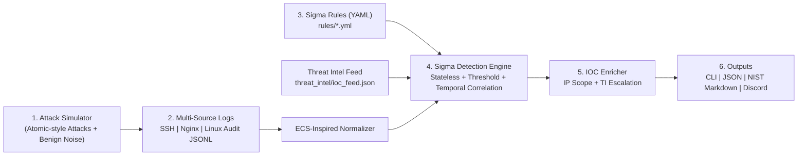

# Detection-as-Code & Purple Team SOC Lab (`detection-as-code-lab`)


A reproducible **Detection-as-Code (DaC)** and **Purple Team SOC Lab** demonstrating the full security operations lifecycle in code:

> **Controlled Attack Simulation → Multi-Source Log Normalization → Sigma Rule Evaluation & Correlation → Threat Intel IOC Enrichment → Actionable SOC Alerts & NIST SP 800-61 Reporting**

---

## Architecture



---

## Key Engineering Highlights

- **Sigma Detection-as-Code (`rules/*.yml`):** 8 versioned, schema-validated Sigma rules supporting modifiers (`|contains`, `|startswith`, `|endswith`, `|re`, `|all`), safe boolean condition evaluation (no `eval()`), sliding-window thresholds (`count() by source.ip >= N`), and **multi-stage temporal correlation** (SSH brute force followed by successful login from the same IP).
- **Zero-False-Positive Design:** Every rule includes explicit exclusion filters (e.g., `/health` probes, `backup_agent`, `ansible_provisioner`) verified by automated **True Positive + True Negative** unit tests in CI.
- **Multi-Source Log Normalizer (`detection_engine/normalizer.py`):** Auto-detects and normalizes Linux `sshd` syslog, Nginx/Apache combined access logs, and Linux process execution JSONL into unified ECS-inspired fields.
- **IOC Enrichment & Dynamic Severity Escalation (`detection_engine/enricher.py`):** Classifies IP addresses (public/private/loopback via `ipaddress`), extracts embedded C2 IPs/domains from command lines, cross-references `threat_intel/ioc_feed.json`, and escalates alert severity when known threats match.
- **SOC Playbooks & NIST SP 800-61 Incident Report (`docs/`):** Includes actionable runbooks (`PB-001`–`PB-006`) in [docs/playbooks.md](docs/playbooks.md) and a complete simulated incident response report in [docs/incident-report-nist.md](docs/incident-report-nist.md).
- **DevSecOps CI Pipeline (`.github/workflows/ci-detection-as-code.yml`):** Automated Ruff linting, Bandit SAST, Sigma rule validation, TP/TN pytest coverage across Python 3.11 & 3.12, Trivy filesystem & container scans, and non-root (`UID 10001`) Docker image verification.

---

## MITRE ATT&CK Coverage Matrix

| Sigma Rule | Tactic | Technique | Detection Type | Playbook |
| :--- | :--- | :--- | :--- | :--- |
| `rules/ssh_brute_force.yml` | Credential Access | `T1110.001` | Threshold (`>=5` in `5m`) | `PB-001` |
| `rules/ssh_compromise_correlation.yml` | Credential Access / Initial Access | `T1110`, `T1078` | Temporal Correlation (`10m`) | `PB-001` |
| `rules/web_sqli_attempt.yml` | Initial Access | `T1190` | Stateless Regex + Filter | `PB-002` |
| `rules/web_path_traversal.yml` | Initial Access | `T1190` | Stateless Pattern | `PB-002` |
| `rules/web_sensitive_file_scan.yml` | Reconnaissance | `T1595.003` | Threshold (`>=3` in `2m`) | `PB-003` |
| `rules/linux_reverse_shell.yml` | Execution | `T1059.004` | Stateless Pattern + Regex | `PB-004` |
| `rules/linux_credential_access.yml` | Credential Access | `T1003.008`, `T1552.004` | Stateless + Account Filter | `PB-005` |
| `rules/linux_backdoor_user.yml` | Persistence / PrivEsc | `T1136.001`, `T1548.003` | Stateless + Account Filter | `PB-006` |

---

## Quickstart (Zero External Dependencies)

Works out of the box with **Python 3.11+**:

```bash
# 1. Validate all Sigma YAML rules
python -m detection_engine validate-rules

# 2. Run the full end-to-end Purple Team lab (simulate attacks + benign traffic -> detect -> enrich -> export JSON & Markdown)
python -m detection_engine run-lab --scenario all --output-dir lab_output

# 3. Or run individual stages
python -m detection_engine simulate --scenario ssh_compromise --output lab_output/logs
python -m detection_engine detect --logs lab_output/logs --json-out lab_output/alerts.json --markdown-out lab_output/triage.md
```

### Optional: Editable Install & PyYAML / Dev Tools

```bash
pip install -e ".[dev]"
dac-lab validate-rules
dac-lab run-lab --scenario all --output-dir lab_output
pytest --cov=detection_engine --cov=simulator
```

### Optional: Run with Docker Compose

```bash
docker compose up --build
```

---

## Running Detection Unit Tests (True Positives & True Negatives)

```bash
# Standard library (zero dependencies)
python -m unittest discover -s tests -v

# Or with pytest
pytest -v
```

---

## Safety & Ethics Notice

All simulated attacks only generate synthetic log files locally and exclusively use **RFC 5737 test IP ranges** (`192.0.2.0/24`, `198.51.100.0/24`, `203.0.113.0/24`) and private RFC 1918 addresses. See [SECURITY.md](SECURITY.md).
