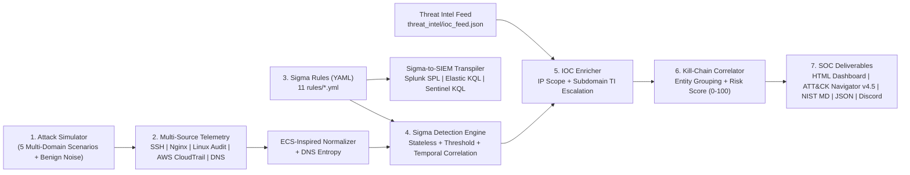

# Detection-as-Code & Purple Team SOC Lab (`detection-as-code-lab`)

[](https://github.com/PH-Vidal/detection-as-code-lab/actions/workflows/ci-detection-as-code.yml)


A reproducible **Detection-as-Code (DaC)** and **Purple Team SOC Lab** demonstrating the full security operations engineering lifecycle in code:

> **Multi-Domain Attack Simulation → ECS-Inspired Log Normalization → Sigma Rule Engine → IOC Enrichment → Cross-Source Kill-Chain Correlation → Interactive SOC Dashboard, ATT&CK Navigator Layer & Production SIEM Export**

---

## Architecture



---

## Key Engineering Highlights (v2.0)

- **11 Versioned Sigma Rules (`rules/*.yml`):** Schema-validated rules across **5 telemetry domains** (Linux SSH, Web/Nginx, Linux Audit, AWS CloudTrail, DNS) supporting modifiers (`|contains`, `|startswith`, `|endswith`, `|re`, `|all`), safe recursive-descent boolean evaluation (no `eval()`), sliding-window thresholds (`count() by source.ip >= N`), and **multi-stage temporal correlation**.
- **Cross-Source Kill-Chain Incident Correlator (`detection_engine/correlator.py`):** Links individual alerts across SSH, Linux Audit, DNS, Web, and AWS CloudTrail by attacker entity into unified **Correlated Incidents (`INC-...`)** with ordered MITRE Kill-Chain progression and transparent **Risk Scoring (0–100)**.
- **Interactive Standalone SOC HTML Dashboard (`detection_engine/dashboard.py`):** Generates a zero-CDN, strictly XSS-escaped (`html.escape`) dark-mode SOC dashboard (`soc_dashboard.html`) with KPI cards, severity distribution bar, Kill-Chain Incident timelines, live severity/text filtering, IOC badges, and expandable raw telemetry evidence.
- **MITRE ATT&CK Navigator v4.5 Exporter (`detection_engine/mitre_navigator.py`):** Exports official ATT&CK Navigator JSON layers (`attack_layer.json`) color-coded by Sigma coverage and live detection severity, ready to import directly into [MITRE ATT&CK Navigator](https://mitre-attack.github.io/attack-navigator/).
- **Sigma-to-SIEM Transpiler (`detection_engine/siem_exporter.py`):** Compiles every versioned Sigma rule into ready-to-deploy **Splunk SPL**, **Elasticsearch/Kibana KQL**, and **Microsoft Sentinel KQL** queries via `dac-lab export-siem`.
- **Zero-False-Positive Design:** Every rule includes explicit exclusion filters (e.g., `/health` probes, `backup_agent`, `ansible_provisioner`, `terraform-ci`, `secops-breakglass`, DKIM lookups) verified by automated **True Positive + True Negative** unit tests in CI.
- **SOC Playbooks & NIST SP 800-61 Reporting (`docs/`):** Actionable runbooks (`PB-001`–`PB-009`) in [docs/playbooks.md](docs/playbooks.md) and a simulated incident response report in [docs/incident-report-nist.md](docs/incident-report-nist.md).

---

## MITRE ATT&CK Coverage Matrix

| Sigma Rule | Log Source | Tactic | Technique | Detection Type | Playbook |
| :--- | :--- | :--- | :--- | :--- | :--- |
| `rules/ssh_brute_force.yml` | Linux `sshd` | Credential Access | `T1110.001` | Threshold (`>=5` in `5m`) | `PB-001` |
| `rules/ssh_compromise_correlation.yml` | Linux `sshd` | Credential Access / Initial Access | `T1110`, `T1078` | Temporal Correlation (`10m`) | `PB-001` |
| `rules/web_sqli_attempt.yml` | Nginx/Apache | Initial Access | `T1190` | Stateless Regex + Filter | `PB-002` |
| `rules/web_path_traversal.yml` | Nginx/Apache | Initial Access | `T1190` | Stateless Pattern | `PB-002` |
| `rules/web_sensitive_file_scan.yml` | Nginx/Apache | Reconnaissance | `T1595.003` | Threshold (`>=3` in `2m`) | `PB-003` |
| `rules/linux_reverse_shell.yml` | Linux Audit | Execution | `T1059.004` | Stateless Pattern + Regex | `PB-004` |
| `rules/linux_credential_access.yml` | Linux Audit | Credential Access | `T1003.008`, `T1552.004` | Stateless + Account Filter | `PB-005` |
| `rules/linux_backdoor_user.yml` | Linux Audit | Persistence / PrivEsc | `T1136.001`, `T1548.003` | Stateless + Account Filter | `PB-006` |
| `rules/aws_iam_privilege_escalation.yml` | AWS CloudTrail | Persistence / PrivEsc | `T1098.001`, `T1098.003` | Stateless + IaC Filter | `PB-007` |
| `rules/aws_cloudtrail_tampering.yml` | AWS CloudTrail | Defense Evasion | `T1562.008` | Stateless + SecOps Filter | `PB-008` |
| `rules/dns_tunneling_exfiltration.yml` | DNS Query Logs | C2 / Exfiltration | `T1071.004`, `T1048.003` | Threshold (`>=4` in `5m`) + Regex | `PB-009` |

---

## Quickstart (Zero External Dependencies)

Works out of the box with **Python 3.11+**:

```bash
# 1. Validate all 11 Sigma YAML rules
python -m detection_engine validate-rules

# 2. Run the full end-to-end Purple Team lab
#    Generates logs, alerts.json, incident_triage.md, soc_dashboard.html,
#    attack_layer.json (ATT&CK Navigator v4.5), and Splunk/Elastic/Sentinel SIEM queries!
python -m detection_engine run-lab --scenario all --output-dir lab_output

# 3. Export MITRE ATT&CK Navigator v4.5 coverage layer standalone
python -m detection_engine export-attack-layer --output lab_output/attack_layer.json

# 4. Transpile all Sigma rules to production SIEM queries (Splunk SPL, Elastic KQL, Sentinel KQL)
python -m detection_engine export-siem --target all --output-dir lab_output/siem_queries

# 5. Run targeted detection on specific logs with HTML dashboard + ATT&CK layer
python -m detection_engine detect \
  --logs lab_output/logs \
  --json-out lab_output/alerts.json \
  --markdown-out lab_output/triage.md \
  --html-out lab_output/soc_dashboard.html \
  --mitre-layer-out lab_output/attack_layer.json
```

### Optional: Editable Install & Dev Tools

```bash
pip install -e ".[dev]"
dac-lab validate-rules
dac-lab run-lab --scenario all --output-dir lab_output
pytest --cov=detection_engine --cov=simulator
```

### Optional: Run with Docker Compose

```bash
docker compose up --build
```

---

## Running Detection Unit Tests (True Positives & True Negatives)

```bash
# Standard library (zero dependencies)
python -m unittest discover -s tests -v

# Or with pytest
pytest -v
```

---

## Safety & Ethics Notice

All simulated attacks only generate synthetic log files locally and exclusively use **RFC 5737 test IP ranges** (`192.0.2.0/24`, `198.51.100.0/24`, `203.0.113.0/24`), RFC 2606 `.example` domains, and private RFC 1918 addresses. See [SECURITY.md](SECURITY.md).
